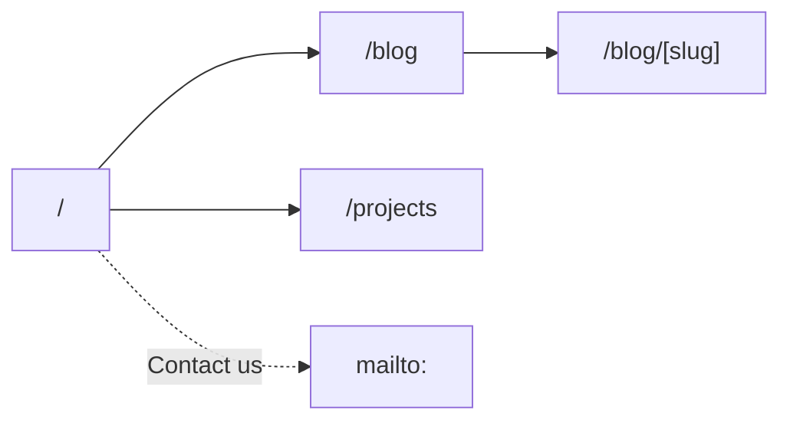

# Astroz — Design Specification

**Status:** Current
**Last updated:** 2026-10-17
**Scope:** Visual system, information architecture, page anatomy, copy, and acceptance criteria for the Astroz site.

`AGENTS.md` is the authority for stack, structure, and commands. This file is the authority for
appearance and wording. If they disagree about appearance or copy, this file wins; if this file
names a path or command that does not exist, `AGENTS.md` wins.

---

## 1. Product definition

Astroz is a community technology movement in Indonesia. The site is its company profile and blog:
it states the belief, explains the mission, lists the projects, and publishes writing.

The site is not a personal portfolio, a research lab, a dashboard, or a CMS. There is no photo
gallery and no donation route.

### Goals

1. State the belief within one screen.
2. Explain the mission in the community's own words.
3. List real projects with a summary and a destination.
4. Publish blog entries without a rebuild per post beyond the content file.
5. Serve English, light and dark, 360px through desktop.

### Non-goals

- No photo gallery, donation flow, newsletter, or contact form.
- No filters, pagination, tags, categories, or search.
- No project detail pages: the index card is the whole presentation.
- No invented metrics, testimonials, or client logos.
- No second design system alongside the shadcn tokens.
- No third-party embeds, analytics scripts, or animation libraries.

### Audience

| Audience | What they need |
|---|---|
| People who share the belief | A clear statement they recognise |
| Prospective collaborators | The pillars, and a way to make contact |
| Visitors evaluating the projects | What was built and where to find it |
| Readers of the blog | Entries with a date and a readable measure |

---

## 2. Voice and copy

### Source of truth

The copy was revised once, in place, to read like a working organization rather than a manifesto.
`ASTROZ TECH.`, `OUR MISSION`, and `MOVEMENT PILLARS` are fixed. Everything else follows the rules
below; a new sentence that breaks one of them is a copy bug, not a style choice.

- **Specific over abstract.** Name the thing: a repository, a workshop, a commit, a demo. If a
  sentence could be pasted onto any technology collective's site, rewrite it.
- **No triads.** Three-item lists are the loudest generated tell on the web. Use two items, one
  item, or a sentence with a subordinate clause instead.
- **No "not X, but Y" antithesis.** It is the same move as a triad with extra syllables.
- **No repeated openers.** "We believe" appears once on the site or not at all.
- **No borrowed aphorisms.** No Napoleon, no famous quotes, no pull-quote attributions. If a line
  is worth setting large, it is a line we wrote about our own method.
- **No em dashes.** Sentences break with a period, comma, or colon.
- **English only.** The nav labels (`Home`, `Blog`, `Projects`, `Donate`), the footer line
  (`© {year} ALL RIGHTS RESERVED.`), body copy, headings, and meta descriptions are English.

### Voice principles

- **Plain and declarative.** Short sentences. No hedging, no marketing adjectives.
- **First person plural.** "We" and "our", not the institutional passive.
- **Method before conviction.** Describe what happens on a Tuesday, not what we believe about the
  future of technology.
- **Uppercase is a design element, not a typing style.** Section headings are authored in caps in
  the dictionary and rendered as-is. Everything else is sentence case.

### Naming

- Wordmark and all references: **Astroz**. Capital A, lowercase remainder.
- Never "Astroz Research", "Astroz Comm.", or a `RESEARCH` descriptor. `ASTROZ TECH.` is the home
  hero headline and nothing else; it is not a name for the organization.
- Metadata name: `Astroz`. Domain: `https://astroz.org`.

### Copy that is deliberately not restored

The previous site was built from the Nextfolio template. These strings were template residue, not
Astroz copy, and are excluded:

- The travel-photo gallery and its captions.
- `Getting Started with Nextfolio` and `Custom MDX Examples`.
- The home `meta-description` about a "clean, fast, and lightweight portfolio template".

---

## 3. Information architecture

### Routes

| Route | Purpose | Nav label |
|---|---|---|
| `/` | Home: hero, pillars + mission, workflow, feed, blog, contact | Home |
| `/blog` | Blog index: heading, list, empty state | Blog |
| `/blog/[slug]` | Blog entry | — |
| `/projects` | Project index: heading, card grid | Projects |

Three top-level routes only: **Home**, **Blog**, **Projects**. Contact is a `mailto:` action, not a
fourth route. There is one language; no locale prefix.



Adding an MDX file under `public/blog/` produces entries with no other change.

### Navigation

**Desktop** — a three-column grid, `md:grid-cols-[1fr_auto_1fr]`, so the link group is centred on
the bar rather than on the space between the wordmark and the controls.

- Left: `AZ` logomark, links home. `/assets/logo-navy.png` (navy ink) in light
  mode, `/assets/logo-white.png` (foreground ink) in dark mode; swapped with `dark:hidden` /
  `dark:block`, no JavaScript. 32px tall, transparent background, `alt="Astroz"`.
- Centre: `Home`, `Blog`, `Projects` — in that order.
- Right: theme toggle, `Donate` button.
- `Donate` opens a QR popover anchored under the button's right edge — the native
  `popover` attribute driven by `popovertarget`, no JavaScript. Top layer, so the sticky header's
  `backdrop-blur` and clipping never affect it; `position: fixed`, `top: 4.5rem`,
  `right: max(2rem, calc((100% - 72rem) / 2 + 2rem))` so its edge lands on the header gutter at
  every width. 272px wide, `rounded-lg`, `border-border`, `bg-popover`.
- Popover contents: mono label `DONATE VIA SAWERIA`, then `/assets/saweria-qr.png` at full panel
  width with `width`/`height` set to its 3000px intrinsic size (no CLS), `alt="Saweria QR code for
  Astroz donations"`, then a `text-sm` instruction line, then an `Open donation page` link to
  `site.donate` with a 16px `ArrowUpRight`, `target="_blank"`, `rel="noopener noreferrer"`.
- Native popover semantics carry the dismissal: `Esc`, outside click, and focus return to the
  button. Never rebuild this as a custom JS overlay.
- Sticky, 64px tall, `bg-background/80`, `backdrop-blur`, 1px bottom border.
- Active route: `text-foreground` with a 2px `primary` underline that wipes in from the left.
- Inactive: `text-muted-foreground`.

**Mobile** — logomark, theme toggle, menu button. The menu opens the shadcn `Sheet` from the
right, `w-[85vw] max-w-sm`, `bg-background`, `overflow-y-auto` so the QR panel can extend it.

- Header: mono label `MENU` in `Label` style over a `border-b` hairline. No large display title.
- Links: `Home`, `Blog`, `Projects` at 18px semibold (`text-lg`), `min-h-14`, one per row, each
  with a `border-b` hairline. No numbering, no icons. Active route `text-foreground` via
  `aria-current="page"`; inactive `text-muted-foreground`. Hover translates the label 4px.
- Footer of the sheet: `Donate` button, then a `ghost` `Close menu` button, `px-5 py-5`, pinned
  with `mt-auto`.
- `Donate` toggles an inline QR panel above itself (`aria-expanded` / `aria-controls`), the same
  `DONATE VIA SAWERIA` label and `/assets/saweria-qr.png` as the desktop popover, plus an
  `Open donation page` link to `site.donate`. The panel collapses whenever the sheet closes.
- Motion, 200–240ms: the panel and overlay transition (`translate 100%` ↔ `0`, `opacity 0` ↔ `1`)
  via `data-state` and `@starting-style`; the sheet body fades in per row with a 35ms stagger
  capped at six steps. The sheet holds its unmount for 220ms so the exit plays. All of it collapses
  to instant under `prefers-reduced-motion: reduce`.
- Focus is trapped while open; `Esc` closes.

**Footer** — one row, hairline top border.

- Left: `Astroz` wordmark, then `© {year} ALL RIGHTS RESERVED.` in mono.
- Right: GitHub, Instagram, LinkedIn as 44×44 icon links, `aria-label` per network, opening in
  a new tab with `rel="noopener noreferrer"`.
- Brand marks are inline SVG in `currentColor`; Lucide has no brand icons. Do not substitute
  generic glyphs.

---

## 4. Design principles

1. **Modern, not luxury.** Sans-only type, strong weight contrast, generous whitespace, hairline
   rules. No serif display, no italic pull quotes.
2. **One accent.** Blue `--primary` marks action, active state, and focus. Everything else is
   neutral.
3. **Hairlines over shadows.** Cards are defined by 1px borders, not elevation.
4. **Type carries hierarchy.** Weight and scale do the work; no colored section bands.
5. **Images are documentary.** Any image is the community's own work. No stock photography.
6. **Motion explains.** 150–250ms transitions on hover, focus, and entrance. No parallax, no
   infinite loops, no scroll-triggered reveals that gate content behind JavaScript.
7. **Dark mode is first-class.** Every token has a dark value.

### Do / Don't

| Do | Don't |
|---|---|
| `rounded-lg` cards with `border-border` | 4px black borders and offset shadows |
| Plus Jakarta Sans headings at 600, body at 400 | Serif display type, italic pull quotes |
| Mono uppercase labels at 11px | All-caps paragraphs outside authored headings |
| One primary CTA per view | Competing colored buttons |
| A −2px hover lift on interactive cards | Scale, rotate, or parallax on cards |
| Text plus tone for status | Color as the only signal |

---

## 5. Design tokens

### Contract

Every color, radius, and font in the UI resolves through the shadcn semantic tokens in
`src/styles/global.css`. Never hardcode a hex, `oklch()`, or `rgb()` in a component.

- Brand and action: `--primary`.
- Hover tint: `--accent`.
- Metadata and secondary text: `--muted-foreground`.
- Hairlines: `--border`; focus: `--ring`.
- Radius: `--radius` plus the `--radius-*` scale.
- **Do not** add `--color-brutal-*`, `--shadow-brutal*`, or parallel color names.

### Light

| Token | Value | Notes |
|---|---|---|
| `--background` | `oklch(0.968 0.004 260)` | Off-white; never `#fff` |
| `--foreground` | `oklch(0.20 0.02 260)` | |
| `--card` | `oklch(0.988 0.002 260)` | Barely lifted off the canvas |
| `--popover` | `oklch(0.988 0.002 260)` | |
| `--primary` | `oklch(0.50 0.18 258)` | `#085dc7`; 5.90:1 against white text |
| `--primary-foreground` | `oklch(0.985 0.003 250)` | |
| `--secondary` / `--muted` | `oklch(0.96 0.008 255)` | |
| `--muted-foreground` | `oklch(0.48 0.02 258)` | ≥ 4.5:1 on background and card |
| `--accent` | `oklch(0.945 0.025 255)` | |
| `--accent-foreground` | `oklch(0.30 0.08 258)` | |
| `--border` / `--input` | `oklch(0.90 0.01 255)` | |
| `--ring` | `oklch(0.50 0.18 258)` | Tracks `--primary` |
| `--radius` | `0.75rem` | |

### Dark

| Token | Value | Notes |
|---|---|---|
| `--background` | `oklch(0.15 0.015 260)` | Deep navy-black |
| `--foreground` | `oklch(0.96 0.005 250)` | Never pure white |
| `--card` | `oklch(0.19 0.018 260)` | |
| `--primary` | `oklch(0.70 0.17 258)` | `#569dff`; 7.11:1 against dark text |
| `--primary-foreground` | `oklch(0.16 0.02 260)` | |
| `--muted-foreground` | `oklch(0.70 0.015 255)` | |
| `--border` / `--input` | `oklch(1 0 0 / 12%)`, `15%` | |
| `--ring` | `oklch(0.70 0.17 258)` | |

### Usage

| Role | Token |
|---|---|
| Page canvas | `bg-background` |
| Body text | `text-foreground` |
| Cards | `bg-card border-border` |
| Secondary text | `text-muted-foreground` |
| Links, active state | `text-primary` / `border-primary` |
| Hover tint | `bg-accent`, `bg-accent/30` |
| Focus | `ring-ring`, 2px with 2px offset |
| Status and tags | `secondary` badge |

**Canvas texture**

Two layers, both behind the content at `z-index: -10` and both `pointer-events: none`:

1. **Paper grain.** `body::before`, fixed, full bleed. A colorless SVG `feTurbulence` mask painted
   with `color-mix(in oklab, var(--foreground) 7%, transparent)` in light mode and `10%` in dark.
   It reads as tooth on the canvas, not as a pattern.
2. **Drafting frame.** `.canvas-frame` in `base-layout.astro`, two 1px dashed rules sitting in the
   page gutters (`max(1rem, calc((100vw - 72rem) / 2 + 0.75rem))` from each edge) in `var(--border)`,
   3px dash / 6px gap. They march 9px downward over 45s. Hidden below `md`, where there is no gutter.

No gradients, glows, dot grids, or mesh backgrounds. Both animations are disabled under
`prefers-reduced-motion: reduce`.

---

## 6. Typography

| Role | Size | Line height | Weight | Tracking |
|---|---|---|---|---|
| Display XL (hero h1) | `clamp(3rem, 7vw, 5.5rem)` | 1.02 | 600 | -0.035em |
| Display L (page h1) | `clamp(2.5rem, 5vw, 4rem)` | 1.05 | 600 | -0.03em |
| H2 | `clamp(2rem, 3.5vw, 3rem)` | 1.1 | 600 | -0.025em |
| H2 compact (CTA) | `clamp(1.5rem, 3.5vw, 2.25rem)` | 1.15 | 600 | -0.025em |
| H3 / card title | `1.5rem` → `1.875rem` at `md` | tight | 600 | -0.01em |
| Lead | `1.125rem` | 1.65 | 400 | 0 |
| Body | `1rem` | 1.65 | 400 | 0 |
| Small | `0.875rem` | 1.5 | 400 | 0 |
| Label | `0.6875rem` | 1.2 | 500 | 0.12em, uppercase, mono |
| Micro label | `0.625rem` | 1.2 | 500 | 0.12em, uppercase, mono |

- Families: Plus Jakarta Sans (`--font-jakarta-sans`) for everything; Geist Mono
  (`--font-geist-mono`) for labels, metadata, tags, and the email address.
- **Sans-only.** No serif fallback in headings, no italic display or pull quotes. Hierarchy comes
  from weight 400/500/600 and scale.
- `text-balance` on headings, `text-pretty` on body copy.
- Prose measure `65ch`; hero lead `48ch`; CTA heading `30ch`. Never full-width paragraphs.
- Minimum body size on mobile: 16px.

---

## 7. Layout and spacing

| Property | Value |
|---|---|
| Content container | `max-w-6xl`, `px-6 md:px-8` |
| Section spacing | `py-20 md:py-28` |
| Card padding | `p-5 md:p-6` |
| CTA panel padding | `p-10 md:p-16` |
| Border | 1px `border-border` |
| Radius | Cards `rounded-lg`, buttons `rounded-lg`, tags `rounded-md` |
| Shadow | None on cards; nav and sheet only |
| Breakpoints | `sm` 640, `md` 768, `lg` 1024, `xl` 1280 |

**Grid behavior**

- Hero: single column; copy capped by the `48ch` lead measure. No image column.
- Mission: single measure column; the source row follows the body at `65ch`.
- Pillars: wrapping tag row.
- Projects: 2 columns `md`, 3 columns `xl`.
- Blog rows: full width with a fixed 160px date column on desktop.
- Header: `md:grid-cols-[1fr_auto_1fr]`.

---

## 8. Components

Primitives are vendored shadcn-svelte: `button`, `badge`, `card`, `sheet`, `separator`. Add only
what a page needs.

### Button

| Variant | Use |
|---|---|
| `default` | The single primary action in a section |
| `outline` | Secondary action beside a primary |
| `ghost` | Nav actions, sheet close |
| `link` | Inline text links |

- Sizes: `sm` 36px, `default` 40px, `lg` 44px.
- Label weight is `font-semibold`; hover lifts −2px.
- Focus ring visible, never removed.
- Icons: Lucide 16px, `stroke-width={1.5}`, 8px gap.

### Badge

- Used for the six movement pillars.
- `variant="outline"` plus `bg-card text-foreground`, so the chip reads as a crisp hairline
  outline against the page in both themes instead of a barely-there filled pill. In dark mode the
  outline is lifted to `dark:border-foreground/30` with `dark:bg-foreground/10`, because the
  default 12% border disappears against the near-black page. Mono 10px, uppercase,
  `tracking-[0.12em]`, `px-3 py-1.5`, `min-h-8`.
- Never use green/amber/red.

### Card

```
rounded-lg border border-border bg-card p-5 md:p-6
```

- Interactive card: renders as `<a>`, hover `-translate-y-0.5 border-primary/40 bg-accent/30`.
- Non-interactive card: renders as `<article>`, no hover.
- Footer row: hairline top border, mono metadata, arrow only when a destination exists.

### Section header

- Eyebrow: mono label, `text-primary`, uppercase.
- Heading: 600, `text-balance`.
- Intro: `text-muted-foreground`, `max-w-2xl`, `text-pretty`.
- Bottom hairline `border-b border-border pb-6 mb-10`.

### Project card

1. Year in mono, `text-muted-foreground`.
2. Title, 600, `text-2xl md:text-3xl`.
3. Summary, `text-sm text-muted-foreground`, `text-pretty`.
4. Footer pinned to the bottom with `mt-auto`: `VISIT PROJECT` and an `ArrowUpRight` that nudges
   on hover, with visually hidden "opens in a new tab". Only when `url` exists.

No role line and no stack tags: the card is year, title, summary, destination.

### Blog row

- Desktop: 160px date column + flexible title column.
- Date in mono, uppercase; brightens on row hover.
- Title 600, `text-2xl md:text-3xl`; slides 4px right and turns `text-primary` on hover.
- Hairline between rows; no card chrome, no summary, no category.

### Prose

- `prose prose-neutral dark:prose-invert max-w-[65ch]`.
- Headings `font-sans font-semibold`.
- Links `text-primary underline underline-offset-4 decoration-primary/30 hover:decoration-primary`.
- Blockquote `border-l-2 border-primary pl-5 font-medium`, no italic.
- Code `font-mono text-sm bg-muted px-1.5 py-0.5 rounded-sm`, highlighted at build time by
  `sugar-high`.

### Motion

| Element | Effect | Timing |
|---|---|---|
| Every page: first-screen elements | `.reveal` fade + 28px rise, cascading top-to-bottom via a computed per-element delay (120ms, then +90ms each, capped at six steps) | 900ms |
| Every page: below-fold elements | Same animation, triggered once as each enters the viewport; never replays | 1000ms |
| Nav links | Underline `scaleX` 0→1 from the left | 200ms |
| Wordmark | Opacity 70% | 200ms |
| Theme toggle | Sun rotates 45°, moon −12° | 200ms |
| Buttons | Lift −2px | 200ms |
| Project card | Lift −2px, border and background tint, arrow nudge | 200ms |
| Blog row | Date brightens, title slides 4px | 200ms |
| Footer social | Icon lifts, glyph scales 1.10 | 200ms |

- Transitions use `translate`/`scale`/`rotate` longhands, not `transform`, so Tailwind v4 utilities
  and transition properties line up.
- `.reveal` is the only entrance mechanism. There is no separate heading animation; the old
  `.rise-in` keyframe set was removed so a page has one behaviour, not two.
- A single inline script in `base-layout.astro` drives it. It runs before paint and sets
  `html[data-reveal="js"]`; the hidden state is scoped to that attribute, so if the script never
  runs (no JavaScript, reduced motion, no `IntersectionObserver`) nothing is hidden.
- **First entry.** On load the script measures every `.reveal`. Elements already inside the
  viewport get an inline `--reveal-delay` of 120ms, then +90ms per element (capped at six steps),
  so the first screen performs a visible top-to-bottom cascade rather than appearing all at once.
  Those inline delays are cleared after 2s, so scrolling back to the top later uses the plain
  class-based behaviour.
- **Scrolling.** An `IntersectionObserver` adds `.is-revealed` the first time an element enters the
  viewport and then unobserves it. The animation is one-shot: scrolling past an element and back
  does not replay it.
- The reveal uses `1000ms cubic-bezier(0.16, 1, 0.3, 1)` — fast arrival, long settle. There is no
  exit transition: once revealed, an element stays visible for the life of the page.
- Under `prefers-reduced-motion: reduce` `.reveal` is set to `animation: none`,
  all transition durations collapse to `0.01ms`, and smooth scrolling is disabled.

---

## 9. Page specifications

### 9.1 Home (`/`)

| # | Section | Anatomy |
|---|---|---|
| 1 | Hero | Full viewport height below the sticky header; single column, vertically centred: h1, lead |
| 2 | Pillars + mission | `border-y` band, two columns: pillars on the left, mission on the right |
| 3 | Workflow | Title and right-aligned subtitle, then a five-step roadmap |
| 4 | Social feed | Section header, then a card grid from the `social` collection |
| 5 | Blog preview | Section header with a link to the blog, then the three newest rows |
| 6 | Contact CTA | Centred card: h2, then the contact button |

**Hero**

- The hero occupies exactly one screen: `min-h-[calc(100svh-4rem-1px)]` — the viewport minus the
  64px header and its 1px border — with `flex items-center` so the copy sits on the optical centre
  line. Nothing from the next section is visible on load.
- H1: `ASTROZ TECH.` at Display XL.
- Lead: `We are dedicated to developing open-source software innovations. By publishing and
  launching projects, we are committed to contributing to the development of intellectual property
  in the future.`
- No image, no eyebrow above the h1, no tag row, and no action buttons: the lead is the only hero
  body below the h1.

**Social feed**

- H2 `FROM THE FEED`; intro paragraph. Section header reuses `SectionHeader`, no action link.
- Cards come from the `social` collection, newest first, drafts excluded. The whole section is
  omitted when the collection has no entries.
- Grid `md:grid-cols-2 xl:grid-cols-3`, `gap-6`, equal-height cards.
- Card: `<a>` to `url`, `target="_blank"`, `rel="noopener noreferrer"`, `rounded-lg border
  border-border bg-card`, hover lift −2px plus `border-primary/40`, matching `project-card`.
- Thumbnail frame: `aspect-[16/10]`, `object-cover`, `loading="lazy"`, `decoding="async"`,
  `alt=""` (the title carries the meaning), hairline under the frame.
- Meta row: platform icon + platform name + `·` + date, mono 11px uppercase
  `tracking-[0.12em]`, `text-muted-foreground`.
- Title `h3` at `text-xl font-semibold`; description `text-sm text-muted-foreground`, clamped to
  two lines; `ArrowUpRight` sits bottom-right, no label.

**Pillars + mission**

- One `border-y` band; inner grid `md:grid-cols-[1fr_1.15fr]`, `gap-10 md:gap-14`,
  `px-6 py-20 md:px-8 md:py-28`. Columns stack on mobile.
- Left column: H2 `MOVEMENT PILLARS`, intro paragraph `mt-5`, then six
  badges `mt-6` in a wrapping flex row.
- Right column: `md:border-l md:border-border md:pl-14`; H2 `OUR MISSION`, no icon. Two paragraphs
  at `65ch`, second one `mt-4`.
- Source row `mt-8 border-l-2 border-primary pl-5`: mono label `SOURCE`, then the GitHub link
  (`github.com/AxelMatthew12`) at `text-sm font-medium` with a 16px `ArrowUpRight`, opening in a
  new tab with the visually hidden notice. There is no quotation and no attribution.
- Six badges: `TECH FOR EVERYONE`, `COMMUNITY DRIVEN`, `LEARN & CREATE`,
  `DARE TO EXPERIMENT`, `CONNECT AND INNOVATE`, `COLLABORATION`. Secondary `Badge` at mono 10px
  uppercase `tracking-[0.12em]`.

**Workflow**

- Section sits below the pillars band, `max-w-6xl px-6 py-20 md:px-8 md:py-28`.
- No eyebrow: the section opens directly with the header grid.
- Header: two columns `md:grid-cols-[1.6fr_1fr] md:items-end`. H2 `WORKFLOW`, capped at
  `22ch`. Subtitle in
  `text-muted-foreground`, right-aligned at every breakpoint, capped at `34ch`.
- Roadmap: `<ol>` with `aria-label`, stacked rows, one per step. Each row carries a top 1px
  `border-t` hairline with an 8px `bg-primary` dot at its left end, then a two-column grid
  `md:grid-cols-[minmax(0,13rem)_minmax(0,1fr)] md:gap-x-12`: the sequence number `01` in mono
  `text-primary` and the uppercase step title at 15px semibold on the left, the
  `text-[0.9375rem] leading-[1.65] text-muted-foreground` body capped at `65ch` on the right. Rows
  keep a readable measure at every width; never five narrow columns.
- Five steps: `RESEARCH`, `COLLABORATION`, `DEVELOPMENT`, `EVALUATION`,
  `PUBLICATION AND EDUCATION`.
- On mobile each row stacks: number, title, then body, keeping its top hairline and node.
- The section ends with the roadmap; there is no closing heading below it.

**Blog preview**

- H2 `FROM THE BLOG`; intro paragraph. Section header reuses `SectionHeader` with an action
  link to `/blog`, label `Read the blog`.
- Rows: `getBlogPosts()` sliced to the three newest, rendered with `BlogRow` at `h3`,
  hairlines between rows.
- The whole section is omitted when there are no published entries.

**Contact CTA**

- Panel: `rounded-lg border border-border bg-card`, four 14px `--primary` L-shaped registration
  marks at the corners at 60% opacity.
- Centred stack, `flex flex-col items-center text-center`, `p-8 md:p-12 lg:p-14`.
- Eyebrow: mono `GET IN TOUCH` in `text-primary`.
- H2 at H2-compact, `max-w-[30ch]`, `mt-5`.
- Action: filled `default` button, `lg`, `Contact us` with no icon, `mailto:` from config,
  `mt-10 md:mt-12`, full width below `sm` and auto width above it.
- No address in the markup, no secondary button, and no form.

### 9.2 Blog index (`/blog`)

- H1 `OUR BLOG`, intro paragraph.
- Rows from `getBlogPosts()`, newest first, separated by hairlines.
- Empty state when the collection has no entries: dashed panel with `The first dispatch is being
  written.`, a body line, and `Back to home`. The panel is required; do not hide the section.
- No featured block, no filters, no pagination, no category or reading-time metadata.

### 9.3 Blog entry (`/blog/[slug]`)

- Container `max-w-3xl`.
- Date in mono, uppercase.
- H1 at Display L, `text-balance`.
- Hairline, then `prose`.
- JSON-LD `BlogPosting` with `author` and `publisher` as `Organization`.
- No summary dek, category badge, reading time, citation block, tags, or prev/next navigation.
- OG image is the shared blog card: `/og/blog.png`.

### 9.4 Projects index (`/projects`)

- H1 `OUR PROJECTS`, intro paragraph.
- Grid: 2 columns `md`, 3 columns `xl`, `gap-6`.
- Cards from `getProjects()`, sorted by `year` descending then title ascending.
- No filters, no status badges, no detail route.

### 9.5 Not found (`404`)

- `404` label, heading, body, `Go home` button. Rendered in English.

---

## 10. Language and copy

- One language: English. No locale prefix, no language toggle, no Astro `i18n` config, no
  dictionary module.
- Copy is written directly in the page or component that renders it. There is no translation
  layer, no key indirection, and no `t()` helper.
- Set `<html lang="en">`.
- Format dates with `Intl.DateTimeFormat("en-US", ...)`. No relative dates: they freeze at build
  time.
- Internal links are plain absolute paths (`/blog`, `/blog/<slug>/`).
- Legacy `/en/...` and `/id/...` URLs redirect via `public/_redirects`.

---

## 11. Accessibility

Target: WCAG 2.2 AA.

- **Contrast:** `muted-foreground` on `background`/`card` ≥ 4.5:1; `primary-foreground` on
  `primary` ≥ 4.5:1 (5.90:1 light, 7.11:1 dark); `primary` as text ≥ 4.5:1.
- **Focus:** 2px `ring-ring` with 2px offset on every interactive element.
- **Landmarks:** one `header`, `nav`, `main`, `footer`; skip link to `#main`.
- **Headings:** one `h1` per page; no skipped levels.
- **Keyboard:** the mobile sheet traps focus, closes on `Esc`, returns focus to the trigger.
- **Links:** descriptive text. External links get `rel="noopener noreferrer"` and a visually
  hidden "opens in a new tab".
- **Motion:** honor `prefers-reduced-motion: reduce`.
- **Images:** meaningful `alt`; decorative images `alt=""`.
- **Language:** `<html lang="en">`.
- **Targets:** 44×44px minimum on touch.

---

## 12. SEO and metadata

- `site` in `astro.config.mjs` is `https://astroz.org`; absolute URLs derive from `Astro.site`.
- Per-route titles: `Astroz`, `Blog | Astroz`, `Projects | Astroz`.
- Meta descriptions are the shipped Indonesian strings `Artikel Astroz` and `Inisiatif Astroz Org`,
  because that is what the original site published.
- Canonical URLs are unprefixed. There are no `hreflang` alternates.
- OG images: one per section, generated at build time by `src/pages/og/[...slug].png.ts` as
  `/og/{home,blog,projects}.png`. There are no per-entry images.
- JSON-LD: `Organization` on home (`name`, `description`, `url`, `sameAs` social links);
  `BlogPosting` on entries.
- Sitemap via `@astrojs/sitemap`; feeds at `/rss.xml`, `/atom.xml`, `/feed.json`.
- `public/_redirects` covers `/`, `/rss`, `/atom`, `/feed`, `/json`, `/sitemap.xml`.

---

## 13. Performance

- Static output. Every route prerendered; no server runtime.
- Two hydrated islands only: theme toggle and mobile nav sheet. No other `client:*`.
- Content is visible without JavaScript: the reveal script exits early and the CSS hidden state is
  scoped to the attribute it would have set. It is the only script outside the two islands.
- Fonts: Plus Jakarta Sans (400/500/600) and Geist Mono (500) via the Astro Fonts API, latin
  subset, preloaded sans.
- Images: explicit `width`/`height`, `decoding="async"`; below-the-fold media lazy-loads.
- Code highlighting runs at build time.
- Targets: LCP < 2.0s on throttled 4G, CLS < 0.05, INP < 200ms.
- No layout shift when the theme toggle mounts; it reserves its 44px box.

---

## 14. File map

```
src/
  components/
    atoms/        code-block.astro, mdx-a.astro, mdx-img.astro, social-icon.astro
    molecules/    blog-row.astro, project-card.astro, section-header.astro,
                  social-card.astro, theme-toggle.svelte
    organisms/    site-header.astro, site-footer.astro, mobile-nav.svelte
    ui/           vendored shadcn-svelte primitives
    mdx-components.ts
  layouts/        base-layout.astro, post-layout.astro
  lib/            site.ts, blog.ts, projects.ts, social.ts, feed.ts,
                  og-font.ts, html-entities.ts, utils.ts
  pages/
    404.astro
    index.astro
    blog/index.astro
    blog/[slug].astro
    projects/index.astro
    og/[...slug].png.ts
    robots.txt.ts, rss.xml.ts, atom.xml.ts, feed.json.ts
  styles/global.css
  content.config.ts
public/
  blog/*.mdx
  projects/*.mdx
  social/*.mdx, social/images/*
  fonts/, opengraph-image.png, favicon.png, apple-touch-icon.png, _redirects
```

---

## 15. Acceptance checklist

- [ ] Three top-level routes: Home, Blog, Projects. No Photos, no Donate route, no project detail.
- [ ] Home renders hero, pillars and mission, workflow, social feed, blog preview, and CTA in
      that order.
- [ ] The hero is a single column and reads cleanly at 390px.
- [ ] Every user-visible string comes from the dictionaries; key sets are identical.
- [ ] No copy outside the restored original text and the specified UI strings.
- [ ] No "Astroz Research", no `RESEARCH` descriptor, no research areas.
- [ ] Blog index shows the empty panel when the collection is empty.
- [ ] Project cards show year, title, summary, and destination.
- [ ] Footer shows the wordmark, copyright, and three social icon links.
- [ ] All colors and radii resolve through semantic tokens; light mode has no pure-white surface.
- [ ] Light and dark have equivalent hierarchy and contrast.
- [ ] 360px viewport has no horizontal overflow.
- [ ] Keyboard, focus, and reduced-motion passes complete.
- [ ] `bun run check` and `bun run build` pass.

---

## 16. Defaults for open decisions

- **Contact:** a `mailto:` action, not a form, until a real inbox and spam strategy exist. The
  `Contact us` CTA points at that address; the `Donate` button opens the Saweria QR popover and
  links out to `site.donate`.
- **Photos:** omitted entirely. The original gallery is not part of the current site.
- **Blog:** ships with zero entries. The route and MDX pipeline stay wired.
- **Projects:** one entry, `Astro-Search`. No detail pages; the card links out.
- **Meta descriptions:** the shipped Indonesian strings, verbatim.
- **Imagery:** none on the home page. Any future image is the community's own work; no stock
  photography.
- **Metrics:** none until there is a verifiable source.
